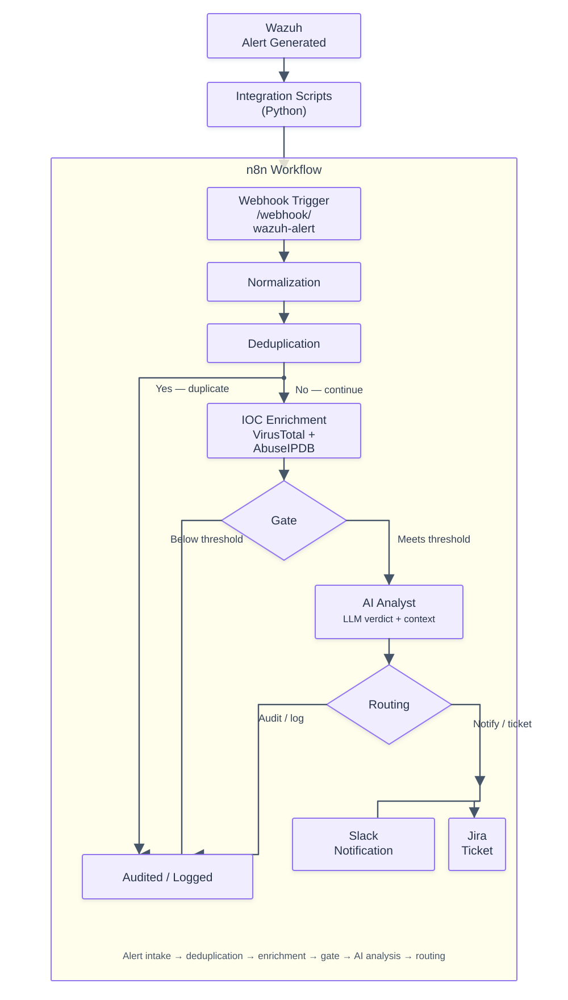
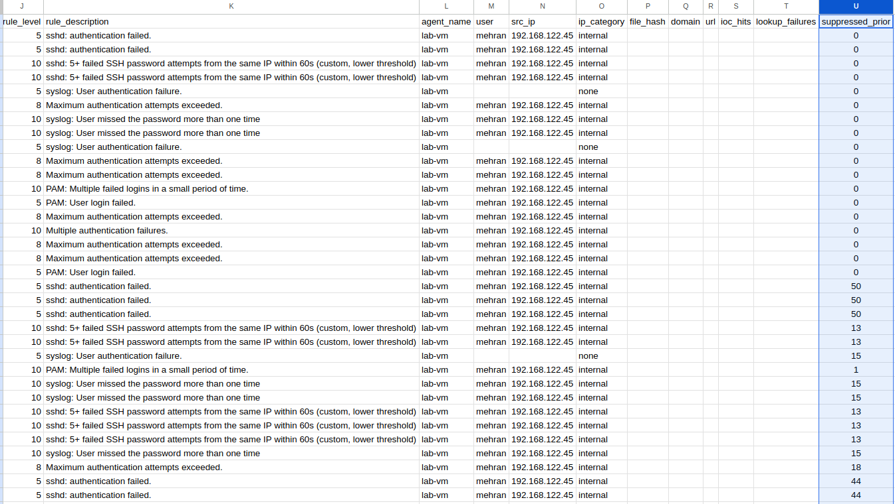
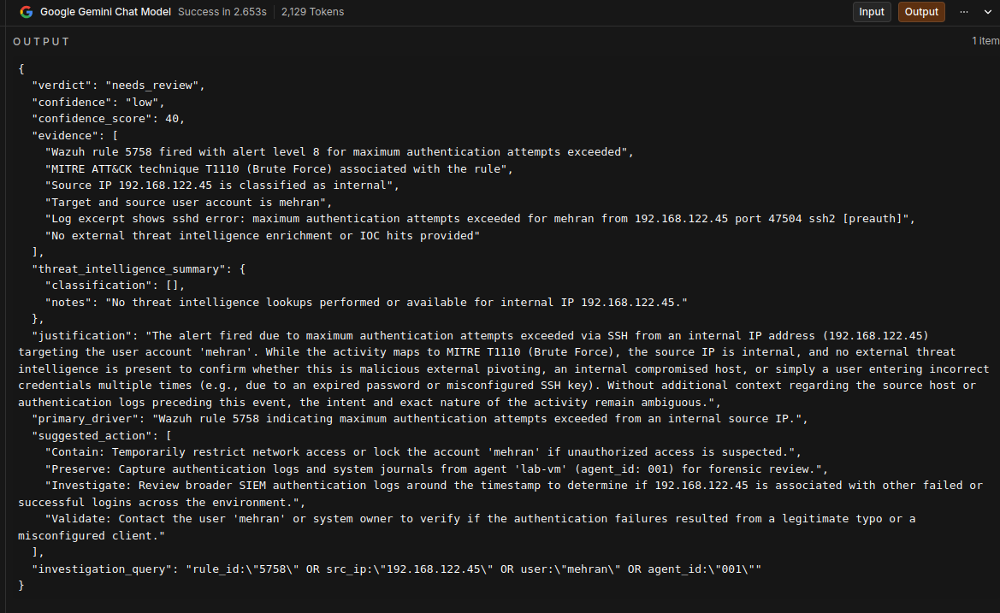
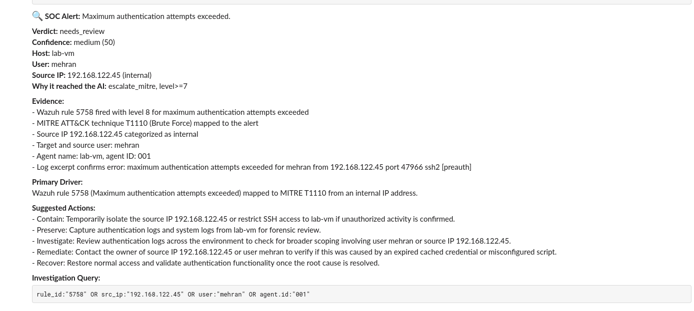
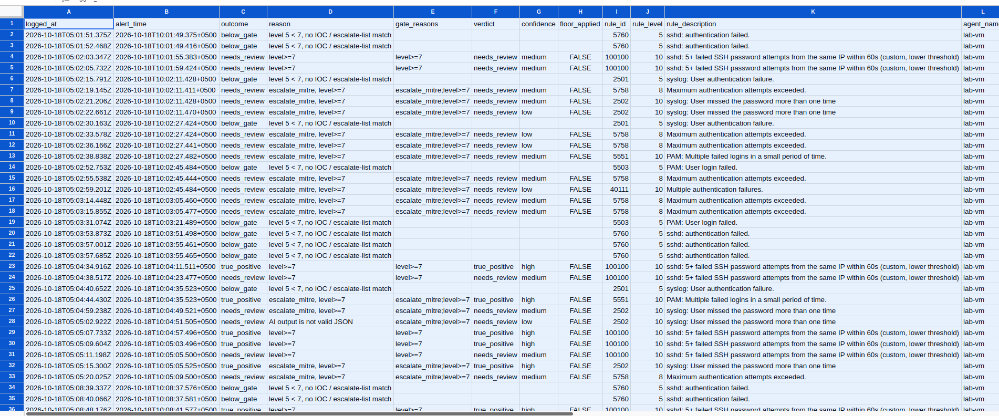

# AI-Augmented SOC Alert Triage Pipeline

An automated alert-triage pipeline built in **n8n**. It receives alerts from **Wazuh**, removes duplicates, enriches public indicators with threat intelligence, decides with explicit rules which alerts deserve an AI analyst, and routes the result to **Slack** and **Jira**. Every alert, escalated or not, leaves a row in an audit sheet.

---
## Technologies Used

| Technology   | Purpose                                        |
|--------------|-------------------------------------------------|
| Wazuh        | Security monitoring / alert generation          |
| n8n          | Workflow orchestration and automation           |
| JavaScript   | Alert normalization, classification, scoring logic |
| AbuseIPDB    | Public IP reputation enrichment                 |
| VirusTotal   | Public IP / indicator reputation enrichment     |
| Groq (LLM)   | Final verdict analysis over combined signals    |
| Jira         | Ticket creation for escalated alerts            |
| Slack        | Real-time analyst notification                  |
| JSON         | Data exchange format between nodes              |

---


## Architecture



## How it works

### 1. Webhook.
 Wazuh's integration script posts each alert to `/webhook/wazuh-alerts`. The webhook requires a shared token in the `X-Webhook-Token` header.

### 2. Normalization.
 Alerts arrive in different shapes. This step extracts a consistent set of fields from the Wazuh JSON, including the nested `raw_alert`:

| Field | Sources  |
|---|---|
| source IP | src_ip, data.srci, data.win.eventdata.ipAddress, sourceIp |
| user | data.srcuser, data.win.eventdata.targetUserName / subjectUserName |
| command | data.command, data.win.eventdata.commandLine |
| file path | syscheck.path, data.win.eventdata.targetFilename |
| file hash | syscheck.sha256/sha1/md5_after, Sysmon hashes string (SHA-256 preferred) |
| domain | data.win.eventdata.queryName, destinationHostname, or the host of a structured URL |
| URL | data.url or data.win.eventdata.url, only if it is a real http(s):// URL; trailing punctuation is trimmed |


### 3. Dedup
this steo fingerprint the alert based on  rule, agent, user, target user, source IP, command, file path, process, domain and URL ,The fingerprints are compared to each other and droped if duplicate with in the fixed time window  The window is **fixed at 120 seconds** and is not extended by repeats. Suppressed repeats are counted, and the count is attached to the next alert that passes (`suppressed_prior`).




### 4. Enrichment

| Indicator | Lookups |
|---|---|
| public IP | AbuseIPDB and VirusTotal |
| file hash | VirusTotal (SHA-256, SHA-1 or MD5) |
| domain | VirusTotal |
| URL | VirusTotal |

Each lookup is stored with its status.

### 5. Gate
An alert goes to the AI if **any** of these is true, and the reasons are recorded on the alert:

| Rule | Default |
|---|---|
| Wazuh `rule.level` at or above the gate level | `7` |
| Rule id on the escalate list | empty |
| MITRE technique on the escalate list | `T1110`, `T1003`, `T1021`, `T1078` |
| A lookup came back malicious | AbuseIPDB confidence ≥ `50`, or VirusTotal malicious engines ≥ `3` |

Anything else is written to the audit sheet as `below_gate` with the reason.

### 6. AI Analyst



The model receives a slimmed JSON of the alert . It returns a structured verdict: 
- verdict,
- confidence,
- evidence,
- justification,
- primary_driver, 
- suggested_action
- investigation_query

### 7. Parsing 
 The reply is parsed and validated:

- The verdict must be exactly **true_positive**, **false_positive** or **needs_review**. Anything else, unparseable output, missing fields or an AI call error becomes `needs_review`, with the alert's own evidence attached.
- **Verdict floor:** if the AI says `false_positive` but the alert has `rule.level` ≥ `12`, a malicious IOC or an escalate-list match, the verdict is raised to `needs_review` and the message says so. The model can never wave a high-severity alert through on its own.

### 8. Routing
 `true_positive` and `needs_review` go to Slack and Jira. `false_positive` goes to the audit log only. The Switch has a fallback output that behaves like `needs_review`.

 

### 9. Audit log
 One Google Sheet row per alert outcome. Suppressed repeats are counted, not written, to avoid flooding the sheet during a brute force.



---

## Configuration

Everything tunable is in one place: the `Config` Code node.

| Setting | Default | Meaning |
|---|---|---|
| `gateLevel` | `7` | Minimum Wazuh `rule.level` that reaches the AI. Pick it from your own level distribution (see below). |
| `floorLevel` | `12` | AI may not downgrade alerts at or above this level to `false_positive` |
| `escalateRuleIds` | `[]` | Rule ids that always reach the AI |
| `escalateMitre` | `T1110, T1003, T1021, T1078` | MITRE techniques that always reach the AI |
| `abuseMinConfidence` | `50` | AbuseIPDB confidence that counts as malicious |
| `vtMinMalicious` | `3` | VirusTotal malicious engine count that counts as malicious |
| `dedupWindowSec` | `120` | Fixed dedup window |


---

## Repository layout

```
.
├── README.md
├── Deployment/
│   ├── docker-compose.n8n.yml   # n8n only (Wazuh runs natively)
│   ├── n8n-workflow.v2.json     # the workflow
│   └── Deployment_Guide.md      # full setup, troubleshooting, operations
├── Integration/
│   ├── python.py                # Wazuh integration script (installed as custom-n8n.py)
│   └── bash                     # Wazuh's wrapper (installed as custom-n8n)
├── tests/
│   └── payloads.json            # sample alert payloads (python.py output format)
└── Screenshots/
```


## Testing

I told Ai to run tests on workflow and it ran 28 tests , all of the tests succeeded and the workflow worked as expected 
 llm generated a report after testing the workflow 

The workflow can be tested with full deployment , Just import the workflow in n8n and use curl command to send different types of alerts 


| Alert | Expected |
|---|---|
| SSH brute force, public IP, AbuseIPDB 100 and VT 11 | AI → true_positive → Slack + Jira + audit |
| Internal SSH failure, level 5 | Audited below_gate, no lookups |
| Windows 4625, IP only inside raw_alert | IP extracted and looked up, then audited |
| Windows 4625 with IP - | No lookups, audited |
| Sysmon level 12 with prompt-injection text; AI answers false_positive | Floor raises it to needs_review; hash looked up, no domain lookup |
| Sysmon level 12, MD5-only hash | MD5 used for the lookup, reaches the AI |
| FIM /etc/passwd, then /etc/shadow 30s later | Both pass dedup and reach the AI |
| Web SQLi level 7 from a public IP | Reaches the AI; only IP lookups, no index.php domain |
| sudo to root, level 3 | Audited below_gate |
| Same brute force at 0 / 30 / 90 / 150s | Pass, suppressed, suppressed, pass with suppressed_prior = 2 |
| ::1, 169.254.x, 100.64.x, 0.0.0.0, ::ffff:10.x, 224.x, 203.0.113.x, garbage | Zero lookups |
| Sysmon DNS evil-c2-domain.net, VT 12 malicious | Domain looked up, IOC sends it to the AI |
| DNS queryName of svchost.exe | No lookup |
| URL with trailing ), | Trimmed, URL and domain looked up |
| VT 429 versus VT 404 on a hash | 429 recorded as a failure; 404 is "not found", not a failure |
| AI returns garbage / errors / invents verdict maybe | needs_review, never lost |
| AI returns True Positive with string evidence | Normalized, arrays coerced |
| AI says false_positive on a level-7 FIM alert | Allowed, audit only |
| Bodies {}, string, null, array, {foo: bar} | malformed audit row, no crash |

### Live checklist

- [ ] Webhook returns 403 without the token and 200 with it
- [ ] SSH brute-force alert from a public IP produces a Slack message, a Jira ticket and a sheet row
- [ ] A level-3 alert produces a sheet row with outcome `below_gate` and nothing else
- [ ] A Windows failed-logon alert shows its source IP in the sheet
- [ ] Repeating an alert within 2 minutes is suppressed, and the next one after the window shows `suppressed_prior`
- [ ] A real Wazuh alert appears in `integrations.log` with status 200


## Limitations

- **Volume is unmeasured.** With the gate at level 7, the AI call rate depends on your alert mix. VirusTotal's free tier allows 4 requests a minute, and an alert can need up to 4. Overflow shows up as `lookup_failures`, not as clean results.
- **Bursts.** Each alert is analysed on its own. n8n's workflow static data is shared between concurrent executions, so a burst can let a duplicate through or undercount the suppressed total. `N8N_CONCURRENCY_PRODUCTION_LIMIT` in the compose file reduces this.
- **No cross-alert correlation.** A brute force followed by a login is judged as separate alerts unless a Wazuh rule combines them.
- **No lookup caching.**
- Suppressed repeats are counted in n8n's static data and are only reported when the next alert for that fingerprint arrives within about 10 minutes.


## Author

Mehran, BS Cybersecurity student. Built as part of a SOC analyst and detection engineering portfolio.
